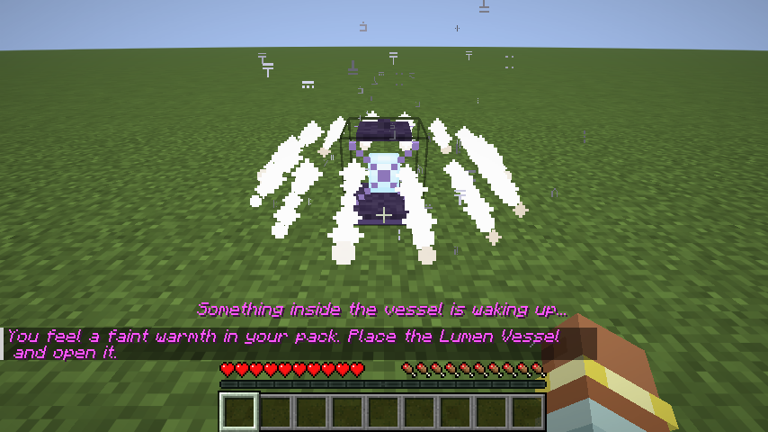
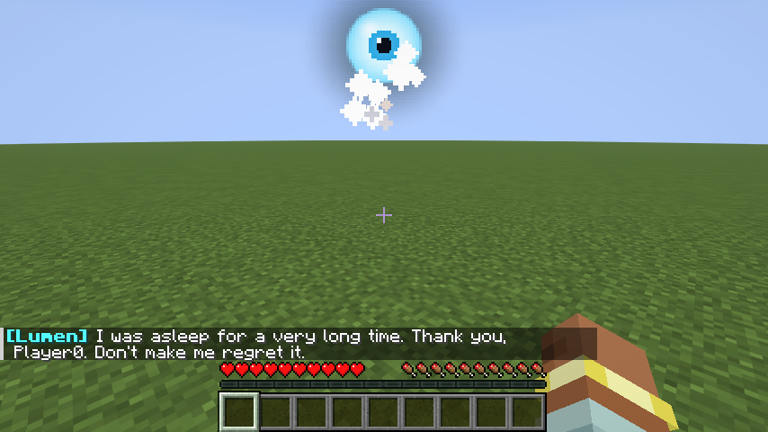
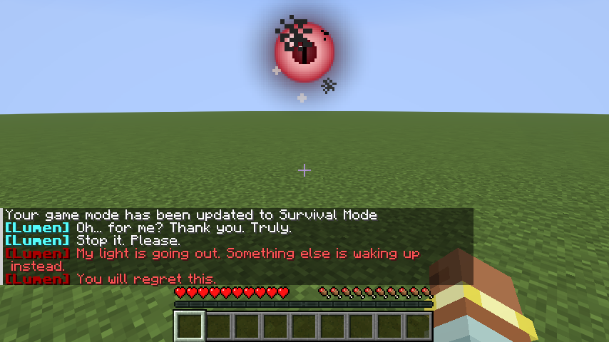
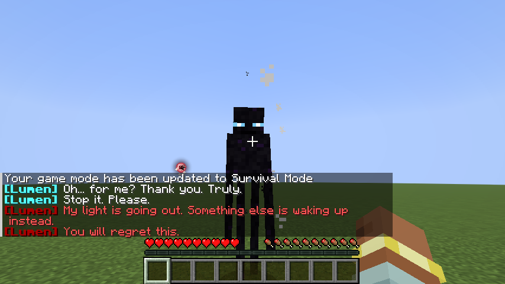

# Lumen

An AI companion mod for **Minecraft Java 1.21.11** (Fabric).

Lumen is a small floating eye of light. Open its vessel and it binds itself to you. It hovers over your shoulder, talks back using an LLM, and remembers how you treat it. If you treat it well, it gives you gifts. If you hurt it, it turns red and calls something out of the dark.

| Awakening | Your Lumen | Betrayed | The Hollow |
|---|---|---|---|
|  |  |  |  |

*(Screenshots are taken automatically by the end-to-end test suite.)*

## Features

- **Lumen Vessel.** Every player gets one the first time they join. Place it and right-click it: a spiral of light tightens around it for five seconds, the glass shatters, and your Lumen wakes up.
  Recipe: amethyst shards in the corners, glass on the sides, an Eye of Ender in the middle.
- **Lumen, the companion.** It hovers over your right shoulder, always faces you, and blinks. It passes through walls and can't be hurt by mobs. It follows you across teleports and dimensions: if it falls behind, it dissolves and re-forms next to you.
- **Talk to it.** Start a chat message with `lumen` (or its name), e.g. `lumen, where do I find diamonds?`, or use `/lumen say ...`. These conversations are private by default.
  - **Online:** set an API key for any OpenAI-compatible endpoint (Groq's free tier is the default). Lumen then has a persona, remembers the conversation, and knows what's around you: biome, dimension, time, weather, health, hunger, held item, and nearby hostile mobs.
  - **Offline:** with no key, Lumen uses built-in dialogue that still understands requests to stay or follow, apologies, insults, thanks, and requests for help. The mod is fully playable without an account.
- **Trust (-100 to 100).** The AI can raise or lower trust based on what you say. Gifts raise it: glowstone, amethyst, glow berries, flowers, golden apples, and Hollow Shards. Hitting your Lumen costs 15 trust.
  - **Calm** (trust 0 or above): a cyan eye. It offers advice and unprompted remarks, warns you when your health is low, and at high trust may drop gifts.
  - **Uneasy** (trust below 0): an amber eye with clipped replies. Trust slowly recovers over time.
  - **Hostile** (trust at or below -50): a red slit-pupil eye trailing smoke, sculk shrieks, and menacing lines. It may summon the Hollow.
- **The Hollow.** A gaunt shadow creature: 40 HP, armored, with glowing eyes. It hunts only the player who angered the Lumen, blinks behind you when you run, and its hits cause Darkness. It fades after 3 minutes. It drops **Hollow Shards**, which are the best gift for winning your Lumen back.
- Shift-right-click your Lumen to toggle stay/follow. Right-click it for a status line and a reaction.
- **Lumen speaks out loud.** Every line is also voiced from the orb's position, and its halo swells as it talks. The voice is made **on your own computer**, so it works offline:
  - **Windows:** the built-in Windows speech voices (nothing to install).
  - **macOS:** the built-in `say` voices (nothing to install).
  - **Linux:** `espeak-ng`, `espeak`, `pico2wave` or `flite` if one is installed (`sudo apt install espeak-ng`).
  - **Fallback:** if none of those is available, a built-in creature "babble" voice, generated in pure Java, so Lumen always has a voice.
  - **Custom:** you can point it at any TTS program, e.g. a neural [Piper](https://github.com/rhasspy/piper) voice (see below).
  - The voice is shaped by mood: bright and echoing when calm, trembling when uneasy, slowed and distorted when hostile.
- **Talk to Lumen with your voice.** Hold **B**, speak, and let go. Your words are transcribed and Lumen answers. This uses the same AI key, with Whisper on Groq or OpenAI. Typing always works without a key.

### Built-in proximity voice chat

Players can talk to each other by voice. Nearby players are louder, and voices pan left and right depending on where the speaker is.

- **Works offline.** Voice travels over the normal Minecraft connection, so there are **no extra ports or accounts**. It works in singleplayer, on LAN, on offline-mode servers, and through any server or proxy that passes mod packets.
- **Push-to-talk** (hold **V**, the default) or **voice activation**.
- **N** mutes or unmutes your microphone. A small HUD shows whether you're talking and who is speaking.
- Pure-Java audio and a lightweight codec (about 65 kbit/s per speaker while they're talking). Nothing native to install.
- Server settings in `config/lumen.json`: `voiceChatEnabled`, `voiceRange` (48 blocks), `lumenVoiceHeardByOthers`.

| Client command (`/voicechat` or `/vc`) | |
|---|---|
| `/vc` | Status: mic device and level, speakers, mode, Lumen voice engine |
| `/vc mode ptt` / `/vc mode voice` | Push-to-talk or voice activation |
| `/vc threshold <dB>` | Voice activation sensitivity (status shows your current mic level) |
| `/vc mics`, `/vc mic <n>` / `/vc mic default` | Choose a microphone |
| `/vc gain <x>` | Microphone boost |
| `/vc volume <%>`, `/vc lumenvolume <%>` | Volume of players' voices / of Lumen's voice |
| `/vc test` | Mic test: hear yourself through the server |
| `/vc lumenvoice auto\|system\|babble\|off` | Choose Lumen's voice |
| `/vc say <text>` | Hear Lumen's voice say something |
| `/vc mute`, `/vc unmute`, `/vc on`, `/vc off` | |

All keys can be changed in Options → Controls → Key Binds → *Lumen Voice Chat*. Client settings live in `config/lumen-voice.json`.

**Custom/neural TTS:** set `customTtsCommand` in `config/lumen-voice.json`. Use `{text_file}`, `{text}` and `{wav}` as placeholders, e.g.
`piper --model /path/en_US-amy-medium.onnx --input_file {text_file} --output_file {wav}`.
Set `systemVoiceName` to pick a specific Windows voice, `say -v` voice, or espeak voice.

**macOS:** the first time you join, allow microphone access for Minecraft (or your launcher's Java) when asked. You can also do this in System Settings → Privacy & Security → Microphone.

## Commands

| Command | |
|---|---|
| `/lumen say <message>` | Talk to your Lumen (same as `lumen, <message>` in chat) |
| `/lumen call` | Bring it to you from anywhere |
| `/lumen stay` / `/lumen follow` | Set its mode |
| `/lumen status` | Show its name, trust, mood, mode, and AI status |
| `/lumen name <name>` | Rename it (chat messages starting with the new name also reach it) |
| `/lumen forget` | Clear its conversation memory |
| `/lumen release` | Unbind it permanently |
| `/lumen reload` | (op) Reload `config/lumen.json` |
| `/lumen trust <-100..100>` | (op) Set your trust, for testing |

## Install

1. Install [Fabric Loader](https://fabricmc.net/use/) 0.17+ for Minecraft 1.21.11.
2. Put [Fabric API](https://modrinth.com/mod/fabric-api) (0.141.6+1.21.11 or newer) and `lumen-1.0.0.jar` in your `mods/` folder.
3. On a server, install the mod on the server. Clients also need it to see the entities and blocks.

## Enabling the AI

After the first launch, edit `config/lumen.json` (or set the `LUMEN_API_KEY` environment variable), then run `/lumen reload`:

```json
{
  "enableAi": true,
  "apiKey": "gsk_...",
  "apiUrl": "https://api.groq.com/openai/v1/chat/completions",
  "model": "llama-3.3-70b-versatile"
}
```

Any OpenAI-compatible chat-completions endpoint works:

| Provider | `apiUrl` | example `model` |
|---|---|---|
| Groq (free tier) | `https://api.groq.com/openai/v1/chat/completions` | `llama-3.3-70b-versatile` |
| OpenAI | `https://api.openai.com/v1/chat/completions` | `gpt-4o-mini` |
| OpenRouter | `https://openrouter.ai/api/v1/chat/completions` | any |
| Ollama (local) | `http://localhost:11434/v1/chat/completions` | `llama3.1` (any key) |

Requests are sent from the **server** off the main thread, so the game never stalls. If a request fails, Lumen falls back to its offline dialogue.

Talking to Lumen with your voice uses `speechToTextUrl` / `speechToTextModel`: Groq's `whisper-large-v3-turbo` by default, or OpenAI's `https://api.openai.com/v1/audio/transcriptions` with `whisper-1`. Speech recognition is the one feature that needs an online AI service. Everything else (voice chat, Lumen's spoken voice, offline dialogue) works without internet.

Other options in `config/lumen.json`: `chatTrigger`, `privateConversations`, `ambientRemarkSeconds`, `hostilityThreshold`, `allowHollowSummons`, `summonCooldownSeconds`, `hollowLifetimeSeconds`, `giveVesselOnFirstJoin`, `memoryLines`, `temperature`, `maxTokens`, `extraPersona`.

## Building

Requires JDK 21.

```sh
./gradlew build                 # -> build/libs/lumen-1.0.0.jar
./gradlew runClient             # dev client
./gradlew runServer             # dev server
xvfb-run -a ./gradlew runClientGameTest   # end-to-end test (drop xvfb-run if you have a display)
```

The client game test boots a real client, creates a world, and plays through every feature with assertions:

- the vessel awakening and the first-join gift
- following, plus stay/follow through chat and through `/lumen say`
- catching up after long teleports and re-manifesting across dimensions, with no duplicate Lumens left behind
- gifts and owner damage changing trust
- the hostile mood and the Hollow summon
- the full AI request/response pipeline against a local mock endpoint
- voice chat: codec quality, push-to-talk frames relayed through the server and back, and nothing sent once the key is released
- Lumen speaking out loud: system speech and the babble fallback for every mood
- speaking to Lumen: microphone audio uploaded as WAV to a mock speech-to-text endpoint and turned into a command
- `/lumen release`

Textures are generated by `tools/gen_textures.py` (requires Pillow).
