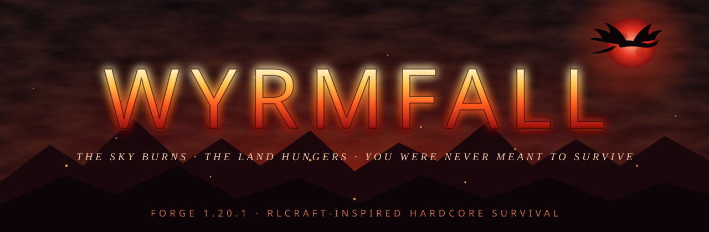

<p align="center"></p>

<p align="center"><b>The dragons came back. The sky has burned for a hundred years.<br>You woke up with six hearts and nothing else.</b></p>

<p align="center">


</p>

---

**WYRMFALL** is a hardcore survival modpack inspired by RLCraft and rebuilt for
modern Minecraft: dragons, bosses, body temperature, thirst, seasons, blood moons,
Soulslike combat and dungeons that want you dead.

## What you're up against

| | |
|---|---|
| 🐉 **Dragons** | Fire, ice and lightning wyrms nest in the mountains, alongside hydras, cyclopes, gorgons and sea serpents (Ice and Fire). Hatch one and ride it if you survive long enough. |
| 💀 **Bosses** | Ignis, the Leviathan and the Harbinger (Cataclysm), Frostmaw, the Ferrous Wroughtnaut and Umvuthi (Mowzie's Mobs), the Lich (The Graveyard), the Dead King (Iron's Spells). |
| 🌡️ **Your body** | Freeze in winter, overheat in the desert, and get sick from dirty water (Tough As Nails). Eat a balanced diet. |
| 🍂 **Seasons** | Crops only grow in season, and winter is long (Serene Seasons). |
| 🌕 **Blood moons** | The moon turns red and the horde comes (Enhanced Celestials). Mobs break doors, use gear and get stronger over time (Improved Mobs). |
| ⚔️ **Combat** | Better Combat swings and combos, dodge rolls, medieval arms, legendary blades and spellbooks. Parkour to escape. |
| 🏰 **The world** | Huge mountains (Tectonic, Terralith), sky fortresses (When Dungeons Arise), catacombs (YUNG's), taverns, villages for every biome, and per-player loot. |
| 🗺️ **No minimap** | Chart the land with an atlas and link waystones. Your corpse keeps your loot, so go back for it. |

## ❤ The Heart Crystal system (WYRMFALL-only)

The pack's own mechanic, built with KubeJS and a datapack:

- You start with **6 hearts**. Difficulty is locked to **Hard**.
- Hostile mobs have a **3% chance** to drop a **Heart Shard** when you kill them.
- **4 Heart Shards around a Golden Apple** craft a **Heart Crystal**.
- **Bosses** drop 1 crystal. **Apex predators** (Ender Dragon, Wither, Warden, Cataclysm bosses, Frostmaw, adult Ice and Fire dragons…) drop **2**.
- **Right-click a crystal** to gain **+1 max heart**, up to **20**.
- **Every death withers one earned heart.** You never drop below 6.
- New players get a title card and a **Survivor's Journal** that explains the rules.

Hearts are stored on the world's scoreboard (`wf_hearts`), so they survive death and relogging.
Admins can adjust them with `/scoreboard players set <player> wf_hearts <0-14>`.

## Install

### Players
1. Download `WYRMFALL-x.y.z.mrpack` from the [Releases](../../releases) page, or from the latest
   [**WYRMFALL** Actions run](../../actions/workflows/wyrmfall.yml) (artifact `WYRMFALL-modpack`).
2. Import it:
   - **Modrinth App**: *+ Create instance → Import from file*.
   - **Prism Launcher**: *Add Instance → Import → choose the .mrpack*.
   - **ATLauncher / MultiMC-likes**: import as a Modrinth pack.
3. Give it **6–8 GB of RAM**.
4. Shaders come preinstalled (Complementary Reimagined). Turn them on in *Options → Video Settings → Shader Packs*.

### Server
```bash
python wyrmfall/tools/make_server.py WYRMFALL-1.0.0.mrpack --out server --memory 8G
cd server && ./run.sh nogui        # run.bat on Windows
```
This downloads only server-side mods (checking every SHA-512), installs Forge and copies the pack's scripts.
Running it means you accept the [Minecraft EULA](https://aka.ms/MinecraftEULA).

## How it's built

```
wyrmfall/
├── pack.json            name, version, Minecraft + Forge version
├── mods.json            every mod: Modrinth slug, side, why it's here
├── overrides/kubejs/    Heart Crystal items, recipes, datapack, splash texts, loading-screen colors
├── tools/build.py       resolves mods and dependencies on Modrinth and writes the .mrpack
├── tools/make_server.py turns the .mrpack into a Forge server
├── tools/smoke_test.py  boots that server and checks WYRMFALL's content
└── tests/               offline tests (fake Modrinth API)
```

Every push runs `.github/workflows/wyrmfall.yml`, which:
1. runs the offline tests,
2. resolves every mod on Modrinth (newest stable Forge 1.20.1 build, plus required dependencies) and writes the `.mrpack`, `resolved.json` (lock) and `report.md` (full mod list),
3. installs a real Forge server from that `.mrpack`, boots it, and checks that the world generates, the Heart Crystal items exist, the datapack functions run and KubeJS reports no errors.

To publish a release, open **Actions → WYRMFALL → Run workflow** and tick *Publish a GitHub release*.
This needs the workflow on the default branch.

### Adding or removing mods
Edit `mods.json`, then push. Set `"optional": true` if the build should skip the mod with a warning when
Modrinth has no Forge 1.20.1 build. Use `"pin": "<version_number>"` to lock a version.
To build locally: `python wyrmfall/tools/build.py --out dist`.

Mods that exist only on CurseForge (Epic Fight, First Aid, Spartan Weaponry…) can't go in a `.mrpack`.
Add them to your instance's `mods/` folder by hand if you want them.

## Credits
WYRMFALL is a curated list: every mod belongs to its authors and is downloaded from Modrinth when you
install the pack. The pack contains no third-party jars. Inspired by Shivaxi's RLCraft.
